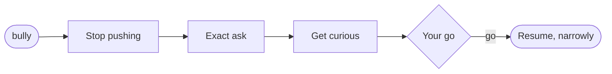

One word that tells your agent it's steamrolling you. `/bully` makes Claude stop pushing, narrow back to what you actually asked, and wait for your go.

## What it does

- **Stops** the next step, the "while I'm here," the side quest
- **Narrows** back to your exact ask, nothing bolted on
- **Asks** instead of asserting
- **Waits** for your explicit go. No "no" is not "yes."



## Install

```bash
mkdir -p ~/.claude/skills/bully
cp SKILL.md ~/.claude/skills/bully/SKILL.md
```

Start a new Claude Code session to pick it up.

## Usage

Type `bully` (or `bully?`, `/bully`) when the agent races ahead of you.

Sibling of [**/bruh**](https://github.com/JR91387/claude-skill-bruh): bully means *right work, wrong pace*. bruh means *wrong work*. If both apply, it's bruh.

## Requirements

- [Claude Code](https://claude.ai/code) with skills enabled

## License

[MIT](LICENSE)

---

Built by **Jerry Reinitz** · [github.com/JR91387](https://github.com/JR91387) · [jerryreinitz.com](https://jerryreinitz.com)<br>
Midwest AI and software engineer who builds for people, not for checkboxes.
